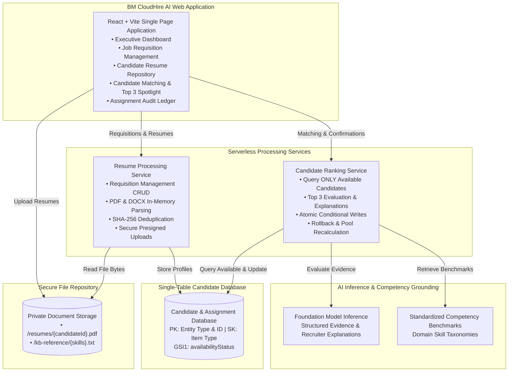

# BM CloudHire AI — Intelligent Recruitment Platform

[](https://aws.amazon.com)
[](#)
[](https://vitejs.dev)
[](https://www.python.org/)

**BM CloudHire AI** is a premium, enterprise-grade AI recruitment platform engineered for talent acquisition leaders, executive recruiters, and hiring panels. It combines automated document parsing, evidence-based candidate scoring, and strict talent exclusion rules across multi-requisition hiring cycles.

---

## 1. Core Platform Capabilities

- **AI Resume Analysis**: Parses PDF and DOCX documents in-memory, extracting technical skills, years of experience, and project evidence with zero biased demographic factors.
- **Secure Resume Storage**: Private, encrypted cloud object storage with SHA-256 hash deduplication to eliminate redundant candidate profiles.
- **Candidate Matching Engine**: Evaluates candidate competencies against job descriptions using standardized competency benchmarks.
- **Smart 100-Point Ranking**: Deterministic arithmetic in Python preventing model hallucinations:
  - Required Skills Match: 40%
  - Relevant Experience: 25%
  - Relevant Projects: 20%
  - Preferred Skills Match: 10%
  - Education & Certifications: 5%
- **Critical Candidate Exclusion Rule**: Once a candidate's assignment is confirmed, they are immediately marked as `ASSIGNED` in the database and **permanently excluded from every subsequent job requisition's eligible talent pool**.
- **Assignment Audit Ledger**: Comprehensive audit log tracking active engagements with controlled, authorized release actions that return candidates to the available pool without destroying history.

---

## 2. Architecture Overview



---

## 3. Running BM CloudHire AI Locally

### Prerequisites
- Windows 10/11
- Python 3.11+
- Node.js LTS (v20+ or v24+)

### Step 1: Open Terminal & Navigate to the Project
```powershell
cd c:\resume_macker
```

### Step 2: Start the Backend API Service (Port 5000)
```powershell
python backend/api_server.py
```
*Listens on `http://127.0.0.1:5000` and connects to the database, secure storage, and AI inference.*

### Step 3: Start the BM CloudHire AI Frontend (Port 5173)
In a second terminal window:
```powershell
cd c:\resume_macker\frontend
npm run dev
```
Open **[http://127.0.0.1:5173/](http://127.0.0.1:5173/)** in your browser.

---

## 4. 10–15 Minute Executive Demonstration Script

Use this structured script when presenting **BM CloudHire AI** to your mentor, leadership team, or clients:

| Time | Screen | What to Say & Demonstrate |
| :---: | :--- | :--- |
| **0:00 - 2:00** | **Executive Dashboard** | Introduce BM CloudHire AI: *"Recruiters struggle with manual resume screening and accidentally reusing the same candidates across different open jobs. Our platform automates matching and strictly enforces candidate exclusion."* Point out the **Candidate Pool Allocation Bar** showing all 20 candidates are currently **Available**. |
| **2:00 - 4:00** | **Job Requisitions** | Navigate to **Jobs**. Show Job 1 (*Senior Full-Stack Cloud Engineer*). Show the search bar filtering by keyword. Click **Create New Job** and demonstrate adding mandatory competencies (40% rubric weight). |
| **4:00 - 7:00** | **Candidate Matching** | Select Job 1 and click **Candidate Matching**. Highlight the **Top 3 Spotlight cards**: Explain the **Evidence-Based 100-Point Scoring**, matched skills (green badges), missing skills (red badges), and the natural language justification explaining why they placed in that position. |
| **7:00 - 9:00** | **Confirm Assignment** | Check the selection box for the Top 3 candidates (*Arun Krishnan, Swati Mukherjee, Divya Balasubramanian*) and click **Confirm Assignment**. Point out the success banner: *"Candidate assignments confirmed; available pool decreased from 20 to 17"*. |
| **9:00 - 11:00** | **Candidate Exclusion Rule** | Switch to Job 2 (*Cloud DevOps Engineer*). Point out the pool count banner: **Only 17 candidates are eligible**. Emphasize that the 3 candidates assigned to Job 1 are **100% excluded** by the database conditional write logic. |
| **11:00 - 13:00** | **Assignment Ledger** | Navigate to **Assignments & History**. Show the permanent audit trail. Demonstrate the **Inspect Analysis** modal and the **Release to Pool** action, returning a candidate back to the pool while preserving the audit record as `CANCELLED`. |
| **13:00 - 15:00** | **Architecture & Q&A** | Conclude with the serverless architecture: private object storage, single-table database design, and lightweight foundation model inference running under standard free-tier allocations. |

---

## 5. AWS Amplify Hosting & Custom Domain Deployment Guide

BM CloudHire AI is fully configured for deployment on **AWS Amplify Hosting**.

### Step 1: Push Code to Git
Initialize and push your codebase to a remote Git repository (GitHub, AWS CodeCommit, or GitLab):
```powershell
git init
git add .
git commit -m "feat: upgrade to BM CloudHire AI platform"
git remote add origin <your-git-repository-url>
git push -u origin main
```

### Step 2: Connect Repository to AWS Amplify
1. Open the [AWS Management Console](https://console.aws.amazon.com/amplify/).
2. Click **Create new app** &rarr; select your Git provider (e.g., **GitHub**).
3. Authorize AWS Amplify and select your repository and the `main` branch.

### Step 3: Configure Build Settings
AWS Amplify will automatically detect the root [`amplify.yml`](./amplify.yml):
```yaml
version: 1
frontend:
  phases:
    preBuild:
      commands:
        - cd frontend
        - npm ci
    build:
      commands:
        - npm run build
  artifacts:
    baseDirectory: frontend/dist
    files:
      - '**/*'
  cache:
    paths:
      - frontend/node_modules/**/*
```
*Note: Verify that `baseDirectory` is set to `frontend/dist`.*

### Step 4: Configure Environment Variables
Under **App settings** &rarr; **Environment variables**, add:
| Key | Value | Description |
| :--- | :--- | :--- |
| `VITE_API_URL` | `https://api.yourdomain.com` (or your deployed API Gateway endpoint) | Public API endpoint for frontend requests. |

> [!CAUTION]
> Never put AWS secret keys or database credentials in frontend environment variables. The frontend only communicates through the public API Gateway HTTPS endpoint.

### Step 5: Single-Page Application (SPA) Routing Rewrite
In AWS Amplify Console, navigate to **App settings** &rarr; **Rewrites and redirects**:
Ensure the following rule is present so refreshing deep routes does not produce a 404 error:
- **Source address**: `</^[^.]+$|\.(?!(css|gif|ico|jpg|js|png|txt|svg|woff|woff2|ttf|map|json)$)([^.]+$)/>`
- **Target address**: `/index.html`
- **Type**: `200 (Rewrite)`

### Step 6: Deploy Application
Click **Save and deploy**. Amplify will provision compute, install dependencies, run `npm run build`, and publish your application to an Amplify-generated HTTPS domain (e.g., `https://main.d123456abcdefg.amplifyapp.com`).

---

## 6. Connecting a Custom Professional Domain in Amplify

To use a custom branded domain (e.g., `hire.yourcompany.com` or `bmcloudhire.ai`):

1. **Navigate to Domain Management**:
   * In the AWS Amplify Console, click **App settings** &rarr; **Domain management**.
   * Click **Add domain**.
2. **Enter Domain Name**:
   * Type your custom domain (e.g., `yourcompany.com`).
   * Configure branch mapping:
     * `hire.yourcompany.com` &rarr; `main` branch
     * Or root `yourcompany.com` &rarr; `main` branch
3. **Configure DNS Records**:
   Amplify generates the required DNS verification records:
   * **CNAME Record**: For subdomain routing (points `hire` to your Amplify CloudFront distribution).
   * **SSL Verification CNAME**: Auto-creates an AWS Certificate Manager (ACM) TLS certificate for HTTPS.
   * Add these records into your DNS provider (Amazon Route 53, GoDaddy, Cloudflare, Namecheap).
4. **SSL / HTTPS Provisioning**:
   Amplify verifies the DNS CNAME, provisions a free managed TLS certificate, and activates HTTPS with automatic renewal.

---

## 7. Troubleshooting Deployment

- **Issue: Page refresh shows 404 on sub-pages**:
  - *Fix*: Verify the SPA redirect rule in Amplify Console (*Rewrites and redirects*) points to `/index.html` with a 200 rewrite.
- **Issue: "Demo Mode" shows instead of "Connected"**:
  - *Fix*: Check that `VITE_API_URL` is configured in Amplify environment variables and points to your live HTTPS API Gateway URL.
- **Issue: CORS error during file upload**:
  - *Fix*: Ensure S3 and API Gateway CORS rules include your Amplify domain (`https://*.amplifyapp.com` and custom domain) in `AllowedOrigins`.
